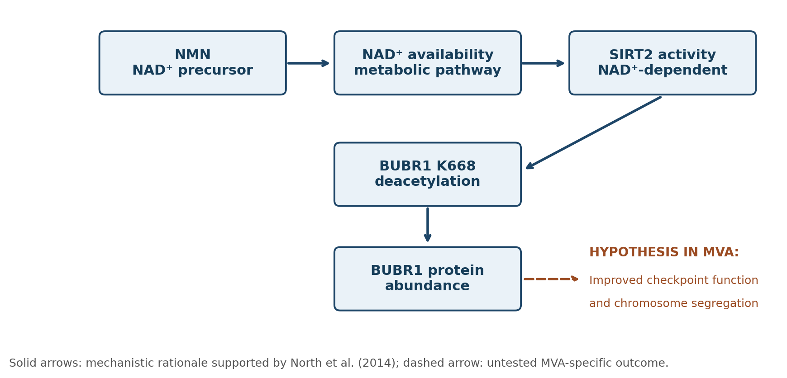

# NMN-Mediated BUBR1 Stabilization in BUB1B-Related MVA

**SageBio MVA Hackathon — literature-based research proposal**

## Overview
Mosaic variegated aneuploidy (MVA) associated with biallelic **BUB1B** variants can involve impaired BUBR1 abundance and spindle assembly checkpoint function. We evaluate **nicotinamide mononucleotide (NMN)** as a *preclinical research candidate* based on published evidence linking NAD⁺–SIRT2 signaling to BUBR1 protein stability.

**Research question:** Can NMN-associated modulation of NAD⁺–SIRT2 signaling increase functional BUBR1 abundance and improve chromosome segregation accuracy in relevant BUB1B-related MVA cell models?

**Important:** No new experiments were performed for this project. NMN has **not** been shown to treat MVA or correct chromosome segregation in MVA patients.

## Mechanistic rationale
NMN → NAD⁺ metabolism → SIRT2-dependent BUBR1 regulation → potentially greater functional BUBR1 abundance → **hypothesized**, not established, improvement in spindle checkpoint activity and chromosome segregation.

## Evidence and limitations
- **Hanks et al. (2004):** genetic evidence connecting biallelic BUB1B mutations with constitutional aneuploidy/MVA.
- **Suijkerbuijk et al. (2010):** BUBR1 dysfunction in patient-derived MVA cells and functional checkpoint rescue with BUBR1 expression.
- **North et al. (2014):** SIRT2 regulation of BUBR1 and increased BUBR1 abundance with NMN in preclinical mice.
- **Not established:** NMN-mediated checkpoint rescue, improved segregation, or patient benefit in MVA.
- **Key caveat:** stabilization may be ineffective if full-length functional BUBR1 is absent.

## Proposed validation
Compare healthy reference cells; MVA vehicle controls; MVA + NMN; MVA + functional BUBR1 restoration; MVA + combination; and MVA + NMN with SIRT2 function disrupted.

**Primary endpoint:** chromosome segregation error frequency. **Secondary endpoints:** full-length BUBR1 abundance, spindle checkpoint function, SIRT2 dependence, and cell health. A protein increase alone does **not** establish functional rescue.

See [references](REFERENCES.md) and [research methodology](METHODOLOGY.md).

## Files
- [Full report (PDF)](Research_Report.pdf)
- [Editable report (Word)](Research_Report.docx)
- [Pathway figure](NMN_BUBR1_Pathway.png)
- [References](REFERENCES.md)
- [Methods and proposed study](METHODOLOGY.md)
- [Privacy and scope notes](PRIVACY.md)
## Status
Literature-based hypothesis and conceptual experiment design only; no clinical recommendation, new data, or validated therapy.
